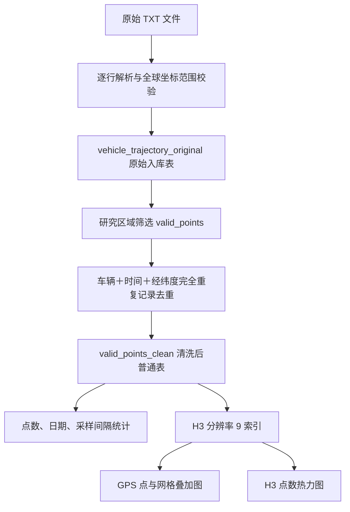

# 北京出租车历史轨迹：清洗、质量检查与 H3 空间分析

数据来源：
T-Drive Taxi Trajectories
下载地址： https://www.kaggle.com
Microsoft Research License

本项目将出租车 GPS 文本导入 PostgreSQL，筛选研究区域内的轨迹点、去除完全重复的记录，再建立 H3 网格并生成统计图和交互式地图。

目前实现了数据质量检查、整体时间分布、活动热点、分小时热点变化和区域间观测转移；停车识别、道路速度与拥堵分析尚未实现。GPS 点数反映采样记录密度，不能直接解释为客流、订单数或拥堵程度。

## 1. 数据与字段

复用或发布数据前请核对下载包中的来源与许可；

数据为无表头、逗号分隔的 TXT，例：

```text
10280,2008-02-02 13:40:45,116.36801,39.87028
10280,2008-02-02 13:45:04,116.38168,39.86473
```

| 字段        | 含义                        | Python / PostgreSQL 类型      |
| ----------- | --------------------------- | ----------------------------- |
| vehicle_id  | 车辆编号                    | int / integer                 |
| recorded_at | GPS 采集时间                | 带时区 datetime / timestamptz |
| longitude   | 经度，TXT 第三列            | float / double precision      |
| latitude    | 纬度，TXT 第四列            | float / double precision      |
| id          | 数据库记录标识，不在 TXT 中 | bigint                        |
| h3_r9       | 分辨率 9 的 H3 网格编号     | str / text                    |

H3 按 WGS84 经纬度计算

## 2. 整体处理流程



这里的“原始入库表”已经跳过无法解析或坐标超出全球范围的行。

不同时间的相同坐标保留，可能是停留；同车同时间的不同坐标也保留，目前未做冲突判定。H3 相同不等于重复点。

## 3. 本次数据结果

清洗表 `valid_points_clean` 共保存 **16,162,423 个 GPS 点、10,290 辆出租车**，时间范围为 **2008-02-02 13:30:44 至 2008-02-08 17:39:19（北京时间）**。全部点已生成并保存 H3 分辨率 9 索引，共覆盖 **67,767 个网格**。

### 数据清洗结果

| 处理阶段     |     记录数 | 结果                                                                    |
| ------------ | ---------: | ----------------------------------------------------------------------- |
| 原始入库     | 17,662,885 | 已通过文本解析和全球坐标范围校验                                        |
| 研究区域筛选 | 17,486,528 | 保留原始入库记录的 99.00%，剔除区域外记录 176,357 条                    |
| 清洗表       | 16,162,423 | 比区域筛选阶段减少 1,324,105 条（7.57%），最终保留原始入库记录的 91.51% |
| H3 索引生成  | 16,162,423 | 覆盖率 100%，h3_r9 无 NULL 或空字符串                                   |

清洗按“同一车辆、同一时间、相同经纬度”去重，不同时间的位置重复保留。

### 每日数据覆盖

| 日期       |  GPS 点数 | 当日去重车辆数 |
| ---------- | --------: | -------------: |
| 2008-02-02 | 1,456,661 |          9,634 |
| 2008-02-03 | 2,839,416 |          9,902 |
| 2008-02-04 | 2,944,698 |          9,977 |
| 2008-02-05 | 2,807,437 |         10,015 |
| 2008-02-06 | 2,307,020 |          9,819 |
| 2008-02-07 | 2,182,360 |          9,462 |
| 2008-02-08 | 1,624,831 |          9,581 |

2 月 4 日 GPS 点数最多，2 月 5 日覆盖车辆最多。首尾两天只覆盖部分时段，每日车辆数分别去重。

### 车辆采样与时间间隔

每车 GPS 点数的最小值为 **1**，中位数为 **1,248**，P95 为 **2,927.3**，最大值为 **148,162**。各车辆采样覆盖不均。

采样间隔统计包含 **16,070,673 对相邻 GPS 记录**，范围为 0～不足 60 分钟；每车首条记录及大于等于一小时的间隔不计入该结果。分布图见第 4 节。

### H3 完成结果

覆盖率 **100%**；不同 H3 网格共 **67,767 个**。这些点可用于按网格统计 GPS 点数、去重车辆数，以及进一步按日期或小时比较空间分布。现有地图文件的生成状态见第 4 节。

数据统计结果见 [data_statistics.json](https://ddddan180.github.io/trajectory_etl/pub/data_statistics.json)。H3 完成结果于由 `h3_snapshot_at` 单独标记统计时间；原始核验结果见 [h3_statistics.json](https://ddddan180.github.io/trajectory_etl/pub/h3_statistics.json)。

## 4. 统计图表及解释

以下图片由 `show_daily_gps_stats()`、`show_gps_count_distribution()` 和 `show_daily_gps_interval()` 直接使用现有 `valid_points_clean` 表生成。点击图片可打开交互式图表。

### 每日 GPS 点数变化

[](https://ddddan180.github.io/trajectory_etl/pub/statistics/daily_gps_stats.html)

由 `show_daily_gps_stats()` 绘制，按北京时间统计去重后的每日 GPS 点数，用于检查日期覆盖与记录量变化。首尾两天仅覆盖部分时段，不能直接与完整日期比较并推断车辆活动下降。查询也返回每日去重车辆数，但本图只展示点数。

### 每辆车 GPS 点数分布

[](https://ddddan180.github.io/trajectory_etl/pub/statistics/gps_count_distribution.html)

由 `show_gps_count_distribution()` 绘制，先统计每车点数，再仅展示点数不高于 P95 的车辆，使用 40 个分箱。用于判断各车辆的采样覆盖是否均衡；高点数尾部没有显示在图中，完整车辆统计见 [CSV](https://ddddan180.github.io/trajectory_etl/pub/statistics/gps_count_distribution.csv)。

### GPS 相邻采样时间间隔

[](https://ddddan180.github.io/trajectory_etl/pub/statistics/daily_gps_interval.html)

由 `show_daily_gps_interval()` 绘制。同一车辆按采集时间、id 排序，用 LAG 计算相邻点时间差，再按整分钟分箱。查询仅包含 0～不足 60 分钟，图默认显示 0～30 分钟；0 分钟桶包括不足 60 秒的间隔，不一定是重复记录。虽然函数名包含 daily，这张图统计的是整个查询时段，并非按日分面。

此图帮助判断采样是否稀疏，但没有展示大于等于一小时的缺口，不能作为完整采样间隔分布。

### H3 空间地图

空间结果以交互式地图查看：

- [GPS 点叠加 H3 网格](https://ddddan180.github.io/trajectory_etl/pub/h3/gps_h3_overlay.html)：默认抽样最多 5000 点，检查位置与网格对应关系；未绘制轨迹连线。
- [H3 网格热力图](https://ddddan180.github.io/trajectory_etl/pub/h3/h3_heatmap.html)：颜色编码每格 GPS 点数，悬停显示去重车辆数，用于观察采样活动集中的区域。

数据库 H3 回填已完成；两份 H3 HTML 已通过数据库聚合与抽样重新生成。HTML 是生成时的快照，不会随数据库更新自动变化。`pub/h3_demo/` 是六条示例数据的验证地图，不用于正式分析。底图需联网加载。

## 5. 分析问题与边界

目前本项目围绕三个问题组织分析：**北京出租车活动热点在哪里、热点如何随时间变化、区域之间如何流动。** 在 [交互分析页面](pub/activity/index.html) 中选择日期、小时和区域，结合统计图判断观测结果及数据覆盖。当前分析对象是这批出租车的 GPS 记录，结论适用于数据覆盖的车辆与时段。

### 活动热点在哪里

交互页面将已保存的 H3 分辨率 9 索引聚合到分辨率 7，以所选时段内的去重车辆数绘制热点地图和 Top 10 排名，也可切换为 GPS 点数。可以识别哪些网格有更多不同车辆出现，并比较车辆覆盖广度与采样记录密度。

去重车辆数表示“所选时段曾在该网格被观测到的不同车辆数”，不表示同时在场数量。同一车辆可以出现在多个网格，各网格车辆数不能相加作为全市车辆总数。点数受采样频率和停留影响，不能单独用来判断车辆聚集程度。

### 热点如何随时间变化

日期和小时筛选联动地图；“网格 × 小时”矩阵展示当前日期范围内全天车辆数最高的 10 个网格，并分别统计各小时的去重车辆数。可以比较同一区域的活跃时段、热点位置和排名变化。选择“全部日期”及某小时，表示各天该小时的合并观测，不是平均每天的活动量。

小时地图在同一日期选择下使用统一色标，便于对比。每个时段的车辆数独立在数据库去重。首尾日期并非完整自然日；采样覆盖不均、长时间缺口和当日观测车辆数变化，都可能影响地图差异。矩阵未观测到的时段显示为 0，不能推断实际没有车辆活动。当前结果描述观测变化，尚未按采样频率或时间覆盖进行归一化，也未检验变化的统计显著性。

### 区域之间如何流动

区域流动视图聚合到 H3 分辨率 6，按同车采集时间、id 排序，将相邻 GPS 点处于不同区域的情况记为一次有方向的观测转移。仅保留时间间隔大于 0 且不超过 600 秒、坐标间近似速度不超过 40 m/s（144 km/h）的记录，转移归属后一个点的日期与小时。

页面按转移的去重车辆数显示主要 Top 20 流向，线宽表示车辆数，悬停同时显示转移次数；可选择某区域查看流入或流出。可以识别观测较频繁的区域连接、比较不同时间的主要流向。同车在同一方向反复移动会增加转移次数，但所选时段内该方向的车辆数只计一次。

地图连线连接网格中心，仅表示方向；不代表实际道路路线、途中经过的全部区域或乘客订单起终点。采样缺口可能跳过中间区域，阈值筛选也会排除部分真实移动。40 m/s 是异常过滤阈值，不是道路限速或经过验证的交通速度标准。页面只展示主要流向，不代表全部区域流动；不同方向的车辆数不能相加作为独立车辆总数。

### 数据与解释边界

- 数据仅覆盖 2008 年 2 月 2 日至 8 日的一批出租车，不能直接推广到全年、当前北京或全部城市交通。
- 源数据需确认为 WGS84 和北京时间；项目未做坐标系识别转换。区域筛选使用经纬度矩形，不等同于北京行政边界。
- H3 网格是分析单元，不是行政区或商圈。当前未关联地名，热点定位依赖地图和网格编号；分辨率 9、7、6 是当前实现的尺度，尚未验证不同尺度下结论的稳定性。粗网格通过 H3 父级索引归并，不是重新对原始坐标划格，父子边界并非严格几何嵌套。
- 完全重复记录已按车辆、时间和经纬度清洗，但同车同时间不同位置的冲突、部分 GPS 跳点仍可能影响分析。停留识别、道路匹配、时间加权活动量和完整采样缺口统计尚未实现。
- 数据没有载客状态、订单、乘客或道路通行信息。热点、时间变化和观测转移不能直接证明乘客需求、载客率、通勤目的、拥堵程度或因果关系。
- 图表和交互页面是生成时的数据快照，不会随数据库自动更新。比较结果时应使用同一统计时段、指标、空间尺度和数据版本，并报告观测车辆数与覆盖情况。

## 6. 代码文件说明

| 文件                   | 职责                                                        |
| ---------------------- | ----------------------------------------------------------- |
| `config.py`            | 从项目根目录 `.env` 加载 DATABASE_URL；已有进程环境变量优先 |
| `etl.py`               | TXT 解析入库、区域筛选、去重定义、统计查询、绘图数据读取    |
| `gps_h3.py`            | 经纬度转 H3、清洗表历史回填、逐批提交与日志                 |
| `charts.py`            | 三个质量统计图、GeoJSON 网格边界、两个地图 Figure           |
| `visualize_h3.py`      | 地图命令行入口与 HTML 导出                                  |
| `export_statistics.py` | 从清洗表导出三个统计图的 PNG、HTML 和 CSV                   |

## 7. 运行步骤

### 环境与连接

建议 Python 3.9 或更新版本。创建虚拟环境、安装依赖：

```bash
python3 -m venv .venv
.venv/bin/python -m pip install -r requirements.txt
```

根目录创建 `.env`：

```dotenv
DATABASE_URL="dbname=postgres user=postgres password=YOUR_PASSWORD host=localhost port=5432"
```

### 导入与准备清洗表

先准备 `vehicle_trajectory_original`，包含 id、vehicle_id、recorded_at、longitude、latitude。

首次导入前，在 `etl.py` 中设置 `data_dir`。按需调用解析和入库函数：

```python
import psycopg
from config import get_database_url
from etl import open_and_parse_files, data_status

with psycopg.connect(get_database_url()) as conn:
    open_and_parse_files(conn)
    data_status(conn)
```

原始表导入完成后，直接筛选研究区域并去重，生成 `valid_points_clean` 普通表。研究区域为经度 115.42～117.50、纬度 39.47～41.08，包含边界；同一车辆、同一时间、相同经纬度只保留 id 最小的一条。

`valid_points_clean` 保存筛选和去重后的实际数据，是 H3 回填、统计查询和地图生成的统一输入。原始表新增数据不会自动同步到清洗表，需要另行执行清洗与同步。

### H3 回填与导出地图

当前清洗表 H3 已全部回填；以下命令用于后续新增记录的回填与地图生成。

```bash
.venv/bin/python gps_h3.py --batch-size 10000
.venv/bin/python visualize_h3.py --max-overlay-points 5000
```

回填每批提交；失败后重新运行会跳过已填 H3 的记录。

地图生成直接使用 `valid_points_clean.h3_r9`，不重新计算 H3。热力图在 PostgreSQL 按网格统计点数和去重车辆数，Python 只接收网格聚合结果；叠加图通过 TABLESAMPLE BERNOULLI 在数据库抽样并 LIMIT，默认最多返回 5000 个点。行级抽样仍需扫描数据页，但不会将千万条记录加载到 Python。若 H3 未全部回填，仅统计已有 H3 的记录；抽样与聚合采用同一只读事务快照。

## 8. 出租车活动交互分析页面

运行 `.venv/bin/python build_activity_dashboard.py`，从 `valid_points_clean` 的完整 H3 数据生成 [活动分析页面](https://ddddan180.github.io/trajectory_etl/pub/activity/index.html)。页面包含日期、小时和指标筛选：

- 活动热点：H3 分辨率 7，以去重车辆数或 GPS 点数着色，显示 Top 10 网格。
- 小时变化：地图随小时滑块切换，配热点网格 × 小时的车辆数矩阵；同一日期各小时采用固定色标。
- 区域流动：H3 分辨率 6，仅展示主要 20 条观测转移，支持区域与流入、流出筛选。线宽表示去重车辆数，箭头表示方向。

转移按同车相邻点识别，跨区域、间隔大于 0 且不超过 600 秒、近似速度不超过 40 m/s 才计入。归属时间使用后一个点，不代表载客订单或真实道路路线。每个筛选时段的车辆数在数据库中独立去重，不通过逐小时车辆数相加估算全天车辆数。

页面为固定快照，数据与 Plotly 内嵌，可直接用浏览器打开；底图需要联网。区域使用 H3 编号，尚未关联行政区或地名。首尾两天不完整，未观测到不等于没有实际活动。
